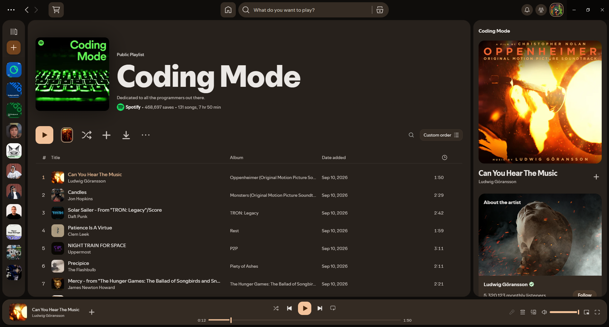

# Expressify

[Русский](README.ru.md)

Material 3 Expressive theme for desktop Spotify ([Spicetify](https://spicetify.app)).

## What it does

- Rounded floating panels, wavy progress bar, morphing Play/Pause and chips, compact What's New cards.
- **Settings inside Spotify (`Ctrl + P`):**
  - Turn the theme on/off without touching your Spicetify config.
  - **Dynamic track colors** — pulls colors from the currently playing track (4 styles: Balanced, Contrast, Vibrant, Cover match).
  - **Expressive+** — tints Home tiles and cards using their own cover art.
  - **UI outlines** — toggle borders around cards, panels, menus, and buttons.
  - Switches between English and Russian automatically based on your Spotify language.
- **Desktop wallpaper sync** (manual install only) — grabs colors from your Windows or Linux wallpaper when dynamic track colors are turned off.

## Install

You need desktop Spotify (not the Microsoft Store version) and **Spicetify** already installed.

### Spicetify Marketplace (easiest)

1. Open **Marketplace -> Themes** inside Spotify.
2. Search for **Expressify**.
3. Click **Install** and reload Spotify.

Everything works out of the box here except desktop wallpaper sync (Spotify doesn't let Marketplace themes run OS scripts).

### Manual install (includes wallpaper sync)

**Windows (PowerShell):**
~~~powershell
irm https://raw.githubusercontent.com/Filiann-n/Expressify/main/install.ps1 | iex
~~~

**Linux (Bash):**
~~~bash
curl -fsSL https://raw.githubusercontent.com/Filiann-n/Expressify/main/install.sh | bash
~~~

If you don't want wallpaper sync on Linux:
~~~bash
curl -fsSL https://raw.githubusercontent.com/Filiann-n/Expressify/main/install.sh | bash -s -- --no-wallpaper-sync
~~~

> Both scripts only check that `spicetify` is installed — they won't install Spicetify for you.

## Updating colors from your wallpaper

When **Dynamic track colors** is off, the theme uses `color.ini`. To refresh it from your wallpaper manually:

- **Windows:**
~~~powershell
& "$env:APPDATA\spicetify\Themes\M3Expressive\scripts\sync-wallpaper.ps1" -Apply
~~~
  Looks for `ii-windows` (`colors.json`) -> `matugen` -> current Windows wallpaper -> Windows accent color.

- **Linux:**
~~~bash
"${XDG_CONFIG_HOME:-$HOME/.config}/spicetify/Themes/M3Expressive/scripts/sync-wallpaper.sh" --apply
~~~
  Looks for `quickshell` / `illogical-impulse` (`colors.json`) -> `matugen` -> active wallpaper (`swww`, `hyprpaper`, GNOME, XFCE, `feh`, `nitrogen`) -> `pywal`.

You can pass `-Style` / `--style` with `tonal`, `expressive`, `vibrant`, or `content`.

## Uninstall

- **Marketplace:** open **Marketplace -> Installed**, find **Expressify**, and click **Remove**.
- **Windows:**
~~~powershell
irm https://raw.githubusercontent.com/Filiann-n/Expressify/main/uninstall.ps1 | iex
~~~
- **Linux:**
~~~bash
curl -fsSL https://raw.githubusercontent.com/Filiann-n/Expressify/main/uninstall.sh | bash
~~~

Restores whatever theme you had before.

## License

MIT