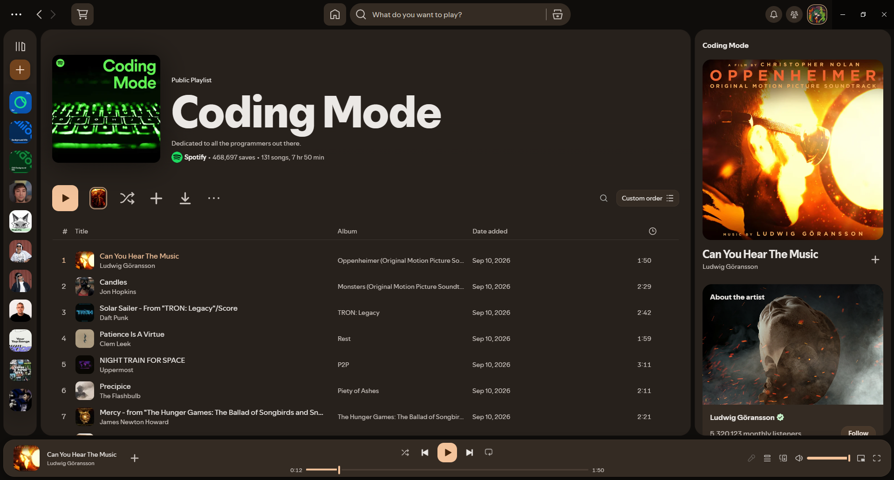

# Expressify

[English](README.md)

Material 3 Expressive тема для десктопного Spotify ([Spicetify](https://spicetify.app)).

## Что умеет

- Скруглённые плавающие панели, волна на прогресс-баре, морфинг кнопок Play/Pause и чипов, компактные карточки в «Новинках».
- **Настройки прямо в Spotify (`Ctrl + P`):**
  - Включить/выключить тему целиком с быстрой перезагрузкой без ковыряния конфига Spicetify.
  - **Цвета от обложки трека** — красит интерфейс под текущий трек (4 стиля: Сбалансированный, Контрастный, Яркий, Цвет обложки).
  - **Expressive+** — подсвечивает плитки и карточки на Главной в цвет их собственной обложки.
  - **Обводка интерфейса** — включает или убирает рамки у карточек, панелей, меню и кнопок.
  - Язык настроек (RU/EN) сам подстраивается под язык Spotify.
- **Синхронизация с обоями** (только при ручной установке) — подтягивает палитру с обоев рабочего стола на Windows или Linux, когда цвета от трека выключены.

## Установка

Нужен обычный десктопный Spotify (не из Microsoft Store) и уже установленный **Spicetify**.

### Через Spicetify Marketplace (проще всего)

1. Открой в Spotify **Marketplace -> Themes**.
2. Вбей в поиск **Expressify**.
3. Нажми **Install** и перезагрузи клиент.

Через Маркетплейс сразу работает всё, кроме подхвата цветов с обоев рабочего стола (внутри Spotify нельзя запускать системные скрипты).

### Ручная установка (с синхронизацией обоев)

**Windows (PowerShell):**
~~~powershell
irm https://raw.githubusercontent.com/Filiann-n/Expressify/main/install.ps1 | iex
~~~

**Linux (Bash):**
~~~bash
curl -fsSL https://raw.githubusercontent.com/Filiann-n/Expressify/main/install.sh | bash
~~~

Если на Linux не нужна подстройка под обои:
~~~bash
curl -fsSL https://raw.githubusercontent.com/Filiann-n/Expressify/main/install.sh | bash -s -- --no-wallpaper-sync
~~~

> Скрипты сами Spicetify не ставят — он уже должен быть установлен в системе.

## Как обновить цвета с обоев

Когда **Цвета от обложки трека** выключены, тема берёт палитру из `color.ini`. Обновить её с обоев можно вручную в любой момент:

- **Windows:**
~~~powershell
& "$env:APPDATA\spicetify\Themes\M3Expressive\scripts\sync-wallpaper.ps1" -Apply
~~~
  Ищет по порядку: `ii-windows` (`colors.json`) -> `matugen` -> текущие обои Windows -> акцентный цвет системы.

- **Linux:**
~~~bash
"${XDG_CONFIG_HOME:-$HOME/.config}/spicetify/Themes/M3Expressive/scripts/sync-wallpaper.sh" --apply
~~~
  Ищет по порядку: `quickshell` / `illogical-impulse` (`colors.json`) -> `matugen` -> активные обои (`swww`, `hyprpaper`, GNOME, XFCE, `feh`, `nitrogen`) -> `pywal`.

Можно добавить флаг `-Style` / `--style`: `tonal`, `expressive`, `vibrant` или `content`.

## Удаление

- **Marketplace:** открой **Marketplace -> Installed**, найди **Expressify** и нажми **Remove**.
- **Windows:**
~~~powershell
irm https://raw.githubusercontent.com/Filiann-n/Expressify/main/uninstall.ps1 | iex
~~~
- **Linux:**
~~~bash
curl -fsSL https://raw.githubusercontent.com/Filiann-n/Expressify/main/uninstall.sh | bash
~~~

Скрипт вернёт тему, которая стояла у тебя до установки.

## Лицензия

MIT